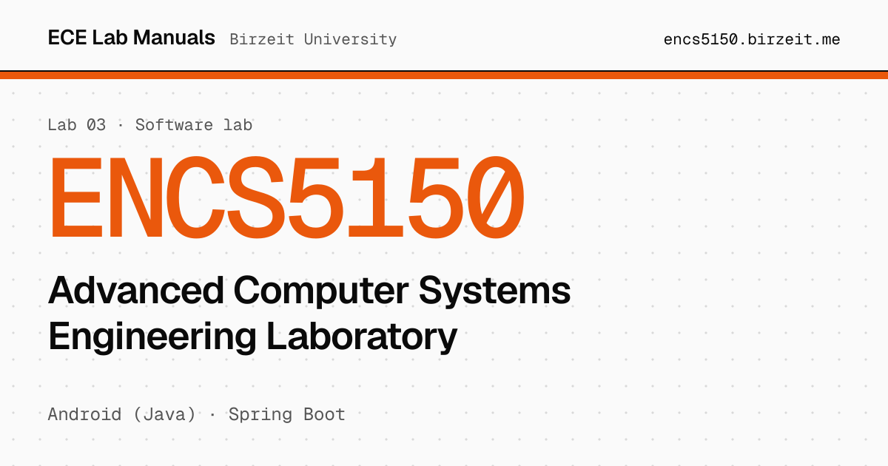

<a href="https://encs5150.birzeit.me"></a>

# ENCS5150 · Advanced Computer Systems Engineering Laboratory

Step-by-step lab manual for ENCS515 / ENCS5150 at Birzeit University: Android apps in Java, local data with SQLite, REST APIs, and the Spring Boot backend that serves them.

**[Open the manual](https://encs5150.birzeit.me)** · [PDF](https://encs5150.birzeit.me/ENCS515-Manual.pdf) · [Setup guide](https://encs5150.birzeit.me/setup) · [All labs](https://birzeit.me)

## Run it locally

Requires [Node.js](https://nodejs.org) 24 and npm.

```sh
git clone https://github.com/ECE-Birzeit/encs5150.git
cd encs5150
npm ci
npm run dev        # http://localhost:5173, reloads as you edit
```

```sh
npm run build      # outputs to .vitepress/dist, fails on dead links
npm run preview    # serve the built site
```

## Project layout

| Path | Contents |
|:--|:--|
| `index.md` | Home page |
| `setup.md` | Setup guide: Android Studio, the emulator, creating lab projects |
| `experiments/` | Experiment index and one page per experiment |
| `snippets/` | Long code files included with `<<< @/snippets/File.java{java}` |
| `public/` | Static files served as-is: logo, link-preview image, manual PDF |
| `.vitepress/config.mts` | Site config: nav, sidebar, search, link previews |
| `.vitepress/theme/custom.css` | Theme colours and overrides |

## Contributing

Found a mistake? Click **Edit this page on GitHub** at the bottom of any page, or [open an issue](https://github.com/ECE-Birzeit/encs5150/issues/new/choose). The [contributing guide](https://github.com/ECE-Birzeit/.github/blob/main/CONTRIBUTING.md) covers writing style and pull requests.

## Deployment

`.github/workflows/deploy.yml` builds and deploys to GitHub Pages on every push to `main`, so merged changes are live within a couple of minutes at [encs5150.birzeit.me](https://encs5150.birzeit.me).

## License

The written content is licensed under [CC BY 4.0](LICENSE): you may share and adapt it, including for your own course, as long as you credit the source. Code, meaning `snippets/` and the site code (`.vitepress/`, `.github/`), is licensed under [MIT](LICENSE-CODE). © 2026 Mohammad Abu-Shelbaia.

Not covered by either license, and still owned by their authors:

- `public/ENCS515-Manual.pdf`, the department's manual

The Birzeit University name and logo are the university's; they are not licensed here. Screenshots of third-party software, and product names and logos, belong to their respective owners.

---

<sub>Part of [ECE Lab Manuals](https://birzeit.me) · Maintained by [Mohammad Abu-Shelbaia](https://github.com/mabushelbaia)</sub>
